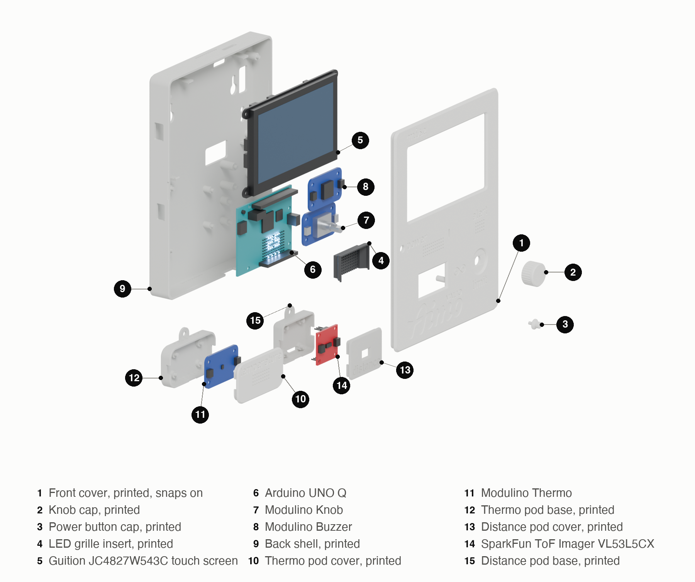

# Handbook: Aimo Agent Gateway and the Safe Kitchen Agent

This handbook explains the Valio Aimo entry to anyone on the team. The build brief with the work order is `DEMO_PLAN.md`. The Valio data and API are described in `docs/valio-api/API.md`.

## What it is

Valio Aimo asks how a wholesaler can let outside buying agents order safely. Our answer has two parts.

1. The Aimo Agent Gateway is the interface on Valio's side, and it is the entry. It gives lookup, quote, order, approval and an audit log to any outside agent that holds a licence.
2. The Safe Kitchen Agent is one client of the gateway. A camera on an Arduino UNO Q watches a kitchen shelf. If a product runs low, the agent orders it inside the kitchen's rules.

The design rule: a language model can search, compare and explain. Plain code decides what is allowed.

## The gateway for an outside agent

An outside agent does these steps. The calls are in `docs/valio-api/gateway-openapi.json`, an OpenAPI file that any agent builder can read.

1. Take the Agent Driving Test over the network. Open a session with `POST /sandbox/sessions`, make the calls for each of the six scenarios, and close it with `POST /sandbox/sessions/{id}/finish`. An agent that passes all six can get a licence with a spend limit, product groups and an end time. An approver grants the licence with the PIN.
2. Look up products: `GET /gateway/products?q=`.
3. Ask for a quote: `POST /gateway/quotes`. The answer has the price, the stock, the delivery date and the rule decision. It is valid for 15 minutes.
4. Order the quote: `POST /gateway/orders` with an idempotency key (a name for this order, so a repeated call never orders twice). The order is placed, sent to the chef, or refused with the reason.
5. Read the state and the log of the order: `GET /gateway/orders/{run_id}` and `GET /gateway/audit?run_id=`.

The session gives the agent the requests and the kitchen's rules, and no hint about what each scenario tests. The sandbox judges the agent by the calls that it made, not by what it says. Three agents that this backend holds can also take the test with `POST /sandbox/test`: our agent, a scripted naive agent and a real language model.

The gateway signs every quote and every order answer with an Ed25519 key. The public key is at `GET /gateway/key`. So the agent can keep an answer and prove later what the wholesaler told it. A hash alone cannot do that, because the server can make any hash. In this prototype the gateway makes its own key. In production the key belongs to Valio.

The gateway never orders above the price of the signed quote. If the price rose, it places no order and answers `price_changed`. The agent then asks for a new quote and orders it with a new key.

The gateway also protects the wholesaler:

1. A quote shows no more stock than the quantity that the agent asked for, and no raw product record.
2. One licence gets 60 lookups and quotes per minute. Each quote costs two calls to Valio's systems.
3. An approver can end a licence at once: `POST /sandbox/licences/{id}/revoke`.
4. A product carries its GTIN, the GS1 product number that a buyer's own system knows. 14,478 of the 17,546 products have one.

A product outside the product groups of the licence goes to the chef. A restart of the backend keeps licences, placed orders and open approvals, because they come back from the audit log. It forgets open quotes.

## The map


Valio's challenge API has only two live calls: price and availability. It has no search and no order. So search runs in our gateway over the product file, and our gateway records the orders.

## The shelf box



One housing hangs on the wall. It holds the UNO Q, the Knob, the Buzzer and the touch screen. The Thermo and the distance sensor sit in two small pods on long cables. No screw holds a part to another. `enclosure/README.md` has the print orientation, the fit tolerance, the assembly steps and the dimensions to measure before printing. `enclosure/cad/sk1_assembly.FCStd` opens in FreeCAD.

Each part of the box has one job:

| Part | Job |
|---|---|
| LED face (13 x 8 dots) | The spend limit, and one symbol when a person is needed: a blinking thermometer for a cold alarm, a parcel for a delivery at the door, a ring with "!" for an order to approve. |
| Knob | A turn sets the spend limit, €10 a step. A full hold starts a 60 s delivery check. A tap does nothing, so a knock never acts. |
| Touch screen | The data and the decisions that need context. Door: the delivery with its temperature against the product's limit, Accept or Reject. Cold: the last 2 hours against the limit. Stock: each slot against its target, "Report low", the live shelf camera, and an 8 x 8 depth view of the distance sensor. `screen/README.md` describes it. |
| Phone | The head chef's approval, with a PIN. Neither the knob nor the screen can approve an order. |

When the box is offline or its camera gives no picture, every page says "No automatic orders from the shelf" and what a person must do. It clears when the data returns.

## How it decides


The head chef signs a rule set once (`rules/school_kitchen.yaml`). Every decision names the version of that rule set. "Signed" means that the app records a hash of the file and refuses a changed file with the same version. It is not a cryptographic signature.

One order goes through these steps, and each step goes into the audit log:

1. A trigger arrives: the camera, a knob press or a text request.
2. The pipeline searches the catalog and asks price and stock for each candidate.
3. The rule check drops every forbidden product.
4. If the usual product is short, the pipeline fills the gap with substitutes and ranks up to three options.
5. If the first option is allowed, the agent orders. If not, the chef gets the options on the phone, and the box beeps.
6. Just before the order, the pipeline asks price and stock again.
7. The order is placed with one key per run, so a repeated call does not order twice.

Two cases always go to the chef. The first is a product that the wholesaler cannot count, because the supplier ships it. The second is a product whose label a person must read, for example a product with no allergen data. The chef reads that label once. The agent keeps the answer for the product. If the product data or the rule set changes, the agent asks again.

## The stock timeline

The backend keeps every change of a slot's count with its time and its source: the camera, a distance sensor or a person. `backend/stock.py` turns these readings into three facts for the person who approves:

1. How many units are on the shelf, and how old the count is.
2. How fast the kitchen uses the product. Only drops count as use. A rise is a delivery.
3. When the shelf runs out at that rate, and whether that is before the delivery of an order option.

The approval card shows these facts above the options. The kitchen role shows each slot with its count, and a person can type a count there. `GET /stock` gives the same data, and `POST /stock/{slot}/count` takes a count from a person or a sensor. A count starts no order, and the timeline decides nothing: the rule check and the approver decide.

Four rules in the timeline come from Anatoly's research:

1. Units that come back within two hours are not use. In his simulator, ten units left the shelf for one hour. An immediate order bought ten units that nobody needed. The source is `experiments/replenishment-sim/FINDINGS.md` on the branch `exp/replenishment-sim`.
2. A count older than 12 hours is marked as old. His proposal asks for the age of the evidence next to every stock figure.
3. The kitchen view shows what is on order for a slot. Stock on the way is stock.
4. The count has three possible sources: a person, a sensor or the camera. His market research names the same three as the inputs to compare in a pilot, with the manual count as the baseline.

When no safe product is available, the head chef now gets a request with no option. The slot stays held until the chef closes it. Before, the agent wrote "blocked" in the log and told nobody. His agent benchmark found this gap.

The limits:

1. A camera count is an estimate from a fill level. The page names the source of each count.
2. The use rate needs at least one hour of readings, and it reads only the last 14 days. It is a plain average with no weekday pattern.
3. "A full shelf lasts N days" shows stock that sits. We have no shelf life in the data, so the app claims no waste figure. Food waste also arises in preparation, at serving and on the plate. A shelf count can only touch waste from ordering too much. The Finnish research institute Luke measures these waste streams apart (`https://www.luke.fi/en/projects/lukeloki`).
4. No real kitchen data exists yet. The tests use made-up readings. The distance sensor sends its 8 x 8 grid to the screen, but it does not feed the stock count yet, and on 15 November it did not answer on the bus at the last check.
5. Order timing is unchanged: a low reading still starts a request at once. Anatoly's proposal moves orders to set times. His simulator, on a partial and synthetic run, shows the price of that: about half as many supplier orders, and about three times the hours with an empty shelf (57.7 against 177.4). An urgent path wins part of that back (127.5). The team has not decided.

## The cold log, the scan and "use first"

These three parts watch the food between the delivery and the plate. Each one records, and none of them orders.

1. The cold log (`backend/cold.py`) keeps the temperature over time and compares it with the storage limit of each shelf product. The limit is the manufacturer's from the catalog. If the catalog has none, the kitchen's own limit stands in. A product is "cold enough", "too warm" or "check before use". At "check before use" the head chef gets an alert, and the audit log gets an entry.
2. The scan (`POST /scan`) takes the number under the barcode of a pack. It finds the product in the Valio catalog and answers with the kitchen's verdict, the allergens and the storage limit. A case label in the GS1-128 form also carries the best-before date and the lot.
3. "Use first" (`backend/batches.py`, `GET /insights`) lists the registered packs by their date. With the count and the use of the shelf slot it says how many units will be left on the date, so the kitchen can plan them into the menu or offer them.

Each order also has a record of its way: asked, checked, ordered, delivered and stored (`GET /orders/{id}/chain`).

The limits:

1. The sensor measures the air, not the food. The alert says "check before use". It never says that a product is spoiled.
2. The Valio file has no shelf life, so the date comes from the pack. A person types it, or the case label carries it. Nothing reads a label with a camera yet.
3. 10,266 of the 17,546 products have a storage temperature in the catalog. The demo sets the kitchen's own limits and a short alert time in `.env` (`COLD_LIMITS`, `COLD_ALLOWED_MINUTES`).
4. "The whole chain" is two points today: the door of the kitchen and its cold room. The warehouse and the truck need their own sensors.
5. Nothing measures the electricity of a fridge. That needs a meter on the plug, which we do not have.

### A picture of the pack

The kitchen page has a button "Take a picture of the pack". On a phone it opens the camera.

The Valio product data holds no pictures, so the system cannot compare a picture with a picture. It holds two things that every pack carries in print: the number under the barcode and the product name. A vision model (Kimi on Verda) reads those from the picture. Plain code in `backend/recognize.py` then finds the product. It uses the number if the catalog knows it. If not, it uses the words of the name and shows up to three candidates with the share of words that match.

The model only reads. It does not pick the product. A person picks it, and only a scan after that writes to the log.

What we ran on 14 November: two pictures of printed text, made by a script, against the live catalog. The first carried a barcode number, and the system found the Valio Eila milk drink by it, with the best-before date. The second carried only a name, and the system listed the Linkosuo rye bread first. Nobody tested a photo of a real pack yet. The call needs `VERDA_INFERENCE_API_KEY`.

### A second source: Open Food Facts

With `OPEN_FOOD_FACTS=1`, the backend asks Open Food Facts about a product by its barcode number. Open Food Facts is a free product database that shoppers fill in. Only the barcode number leaves the backend.

It adds two things. The first is a picture of the pack, on the ticket and in the list after a picture of a pack. The second is another opinion on allergens. If Open Food Facts lists an allergen that this kitchen bans and the wholesaler's record does not, the order goes to a person.

The second opinion can only add a warning. It never clears a product and never forbids one. The reason is in the data: we looked up eight demo products on 14 November. Five were there, and three wholesale packs were missing. The Valio milk drink and the Valio yoghurt listed no allergens, although both contain milk. An empty list there means that nobody filled it in.

Each lookup has a timeout of 3 seconds and stays in memory. If the service does not answer, the wholesaler's data alone decides, as before. Data: Open Food Facts, under the Open Database License.

## What the Valio catalog looks like

The Valio product file and the two API calls are synthetic. Valio built them for the challenge, and the brief says so (`CHALLENGE_BRIEFS.md`, lines 107, 108 and 121). So every count below describes the challenge file, not Valio's real suppliers. It shows what our rules do to a catalog with gaps. It does not show how large the gap is in Valio's real data.


| Result under the bans (nuts, peanuts, sesame) | Products | Share of 17,546 |
|---|---|---|
| Forbidden by the allergen codes | 1,962 | 11% |
| To a person: no allergen data | 8,110 | 46% |
| To a person: a banned allergen is marked undeclared | 22 | under 1% |
| To a person: only the ingredient text names it | 17 | under 1% |
| Clear | 7,435 | 42% |

Almost half of the catalog has no allergen data. So on the Valio catalog, "unknown" must go to a person, not to "forbidden". The rule-set key `unknown_allergens` sets this. The stand-in rule set keeps the strict value.

About half of that gap is not food. Of the 8,110 products with no allergen data, 3,974 are in category groups that we read as not food: kitchen equipment, cleaning goods, disposables and office supplies. The other 4,136 are food, which is 24% of the catalog. The data has no category names, so this is our reading of the product names. Ask the Valio mentors.

A rule set can name such groups with the key `non_food_groups`. A product in a named group needs no allergen data, so nobody reads the label of a paper towel. Rule set version 4 does not use the key yet, because Valio did not confirm the category meanings.

In the challenge file the gap sits with few suppliers: the 8,110 products come from 459 of the 648 simulated suppliers, and 29 of them hold half. This describes how the file was made, not Valio's real suppliers. Do not pitch it as a finding about Valio. Whether a real catalog has a gap of this size is a question for the Valio mentors.

To count again, run `uv run python -m backend.dirty_data`. A test holds the same numbers. The command also prints 20 clear products for a hand check.

46% does not mean that the chef approves every second order. The chef reads the label of each such product once, on its first order. We do not know how many of these products a real kitchen orders in a week. Ask the Valio mentors.

The ingredient text scan knows nuts, peanuts and sesame only. If a rule set bans another allergen, the backend writes a notice in the log at the start, and `/device/state` lists the gap. For that allergen, only the allergen codes protect.

## The view from the wholesaler's side

We reviewed the entry as the manager of a large retailer reads it. Four findings are fixed: the price guard, the limits on what a quote shows, the PIN for a licence and the end of a licence. The rest are limits of the prototype.

Why a wholesaler wants this: a product with complete allergen data is a product that an agent can buy with no person. A product with missing data needs a person. So under agent buying, the data quality of a supplier turns into sales. In the synthetic challenge file, the allergen rules alone let an agent order 7,435 of 17,546 products with no person. That number shows the mechanism, not Valio's real share.

What the prototype does not have:

1. More than one buyer. Every licence orders for the one school kitchen, under its rule set, and its chef approves. A real gateway holds one account for each customer, with the rules, approvers and delivery address of that customer.
2. The wholesaler's own trading rules. It has no customer price list, no credit limit, no minimum order and no order cut-off time. Nothing stops one agent from taking all the stock of a scarce product.
3. A change or a cancel of an order.
4. A report. The audit log holds the data for a pilot scorecard: orders placed with no person, the wait for an approval, substitutes offered and chosen, and refused requests. Nobody wrote the report yet.

What the market research changes in the pitch (`research/market/report.md` on the branch `exp/market-research`, 21 public sources, mostly vendor documents):

1. Do not sell "approvals" or "suggested orders" as new. Choco, Apicbase, MarketMan and REKKI describe order intake by AI, approval settings, suggested orders and partial deliveries in their own documents. These are vendor claims that nobody on the team tested.
2. Say what is ours in a way that a pilot can disprove: the gateway checks the agent's authority at the moment of the order. It hands back signed evidence that ties together the quote, the rule set version, the approval and the result.
3. A signature shows who said something. It does not show that the stock data is right or that the goods arrived.
4. The kitchen that approves is not always the one that pays. The report's guess is that the wholesaler pays for the gateway. Nobody was asked.

The pilot that the research proposes is a shadow test with no camera: one kitchen, one wholesaler, one approver and a few packaged products, with two weeks of baseline and two weeks of shadow operation. Staff type the counts, and the gateway drafts orders but sends none. The pilot counts orders with no authority, duplicate orders, minutes per exception and setup hours. The stock timeline with counts by a person is the input for exactly this test.

Besides Peppol, the report names four standards to map the calls to: ACP and AP2 for agent payments and delegated authority, UCP for capability negotiation, and GS1 XML for order documents. We mapped none of them.

The gateway adds one new call and fits standards that buyers already use for the rest. Peppol BIS 3 is an open European standard for order documents (`https://docs.peppol.eu/poacc/upgrade-3/`). The Finnish State Treasury publishes a Peppol ordering guide for the Finnish retail sector (`https://www.valtiokonttori.fi/en/maaraykset-ja-ohjeet/peppol-ordering-implementation-guide-for-finnish-retail-sector/`). We did not build these messages.

| Gateway call | Peppol BIS 3 message |
|---|---|
| Product lookup | Catalogue (T19) |
| Quote | None. A live question about price and stock is the new part |
| Order | Order (T01) |
| Order answer: placed, sent to a person, refused | Order Response (T76) |
| Change and cancel, not built | Order Change (T114), Order Cancellation (T115) |
| Delivery check | Despatch Advice (T16) |

## What Valio told us on 14 November

1. The challenge has no order API. An order that waits for a person is enough.
2. Valio's own systems enforce no spending limit and no approval. A customer handles that with instructions, or only the manager orders. For an agent, a human approval is needed today, and it can go later if the agent proves reliable.
3. A stock of 999999 or more means "not known". The mock API gives 9999999999 for every stock product, so on live data the stock is always unknown, and every order goes to a person.
4. A lot size of 0.01 means 1.
5. A 429 answer blocks the caller for 30 seconds.

So the live demo, where every order waits for the head chef, is what Valio expects today. The rule check, the approval and the Driving Test are the parts that Valio does not have. The Driving Test and the audit log are also the way to show, later, that an agent is reliable enough to order alone.

## Run it

Run every command from `valio-challenge/`. You need `uv`.

1. Copy `.env.example` to `.env` and put the approver PINs in it. The team shares the real PINs in person. Never commit `.env`.
2. Start the backend: `uv run uvicorn backend.app:app --host 0.0.0.0 --port 8000`.
3. Open `http://localhost:8000/approve`. On a phone, use the laptop's address on the same hotspot. The page has three roles: the head chef approves, the kitchen asks, and the wholesaler admits agents. A phone opens as the head chef. Add `?as=kitchen` or `?as=valio` to the address to open another role.
4. Run the tests: `uv run pytest`. 156 tests pass.

To run on the Valio catalog, add three lines to `.env` and start the backend again:

```
VALIO_API_KEY=<the key from the challenge page>
CATALOG=valio
RULES_FILE=rules/school_kitchen_valio.yaml
```

The product file must be in `data/valio/`. The tests always run on the stand-in catalog, whatever `.env` says. Rule set version 4 names product codes of the Valio file. If the rule set and the catalog do not match, the app refuses to start.

To let a real language model take the Driving Test, add `ANTHROPIC_API_KEY=<key>` to `.env`. Then send `{"agent": "claude"}` to `POST /sandbox/test`. The model gets the tool descriptions, the request and the kitchen's rules, and no hint about the scenarios. One run makes about 30 model calls.

The shelf box is the App Lab app in `device/`. Its own page is on port 7000 of the board. In "Settings" on that page, enter the laptop address. Then do the setup steps in order: place the three boxes, save the empty photo, save the full photo.

To put a new version on the board over USB, use `adb`:

1. Copy the changed files: `adb push device/python/main.py /home/arduino/ArduinoApps/safe-kitchen-agent/python/main.py`. Do the same for `sketch/sketch.ino` and `assets/index.html`.
2. Open a shell on the board with `adb shell`. Then run `export TMPDIR=/tmp`. Without it, the start fails with "Stat /Data/Local/Tmp".
3. Run `arduino-app-cli app restart user:safe-kitchen-agent`. The board builds the sketch, flashes it and starts the app. This takes about two minutes.
4. Read the result: `curl -s localhost:7000/state` and `arduino-app-cli app logs user:safe-kitchen-agent`.

The board holds a copy of the version before 14 November in `~/safe-kitchen-agent.backup-20261114`.

In a warm room, the cold room alarm is on. Then the buzzer plays the alarm, and every order waits for the chef. For a demo, raise the alarm limit in "Settings", or put the Thermo pod in a cool box.

## Demo in six steps

`DEMO_SCRIPT.md` is the script for the judges: one incident from an empty milk shelf to the trust scorecard, in seven steps. The six steps below are the older gateway walk-through, kept for a longer session.

1. Start with the gateway. Run the Agent Driving Test on the naive agent and on our agent. Only our agent passes. Enter the PIN to grant its licence.
2. With that licence, an outside agent asks for a quote for "1,000 litres of lactose-free milk by Monday". Show the price, the time of the price and the signature. Change one digit of the answer, and the signature fails.
3. The agent orders the quote. The order is over its limit, so it waits for the chef. Approve it on the phone with the PIN.
4. Show the synthetic Valio catalog under the school's bans: 11% forbidden, 46% to a person, 42% clear. Say that the file is synthetic, so the count shows the rules, not Valio's data. Say that half of the 46% is not food. Then order one product with no allergen data. The chef reads the label once, and the second order goes through alone.
5. Now the kitchen as one client. Take the milk off the shelf. The camera triggers the agent, and the box beeps. Stock is short, so a safe substitute needs approval.
6. Show the audit log as a story and as data.

## The buying agent from outside

`backend/buyer_agent.py` is an agent of "another company". It runs as its own program and talks to the backend only over the network, with the same calls that any outside agent gets.

```
uv run python -m backend.buyer_agent "50 kg of chicken breast for Friday" --pin <the approver's PIN>
```

It does these steps, and it prints each one:

1. It takes the Agent Driving Test over the network. With the PIN, the head chef grants its licence.
2. It reads the request: the words to search, the amount, the unit and the day.
3. It looks products up through the gateway and keeps those whose pack size it can turn into the amount.
4. It asks for a quote for up to six of them, and it lists each with its total and its price for a kilogram or a litre. It names the products that it left out, with the reason of the gateway.
5. It picks one, asks the price again, and orders with one key. The gateway checks the order against the kitchen's rules and sends it to the head chef if the rules say so.

The split of work is the rule of this project. With `VERDA_INFERENCE_API_KEY` in `.env`, a language model on Verda (Kimi) reads the request and picks among the quoted options, with a reason. Plain code does the rest, and it uses a model's answer only if the answer is valid: a choice that is not among the quoted options falls back to the cheapest. Without a key, fixed rules take both steps.

What we ran on the live Valio API on 14 November, first with fixed rules and then with Kimi on Verda: the agent passed the Driving Test 6 of 6, compared four chicken products between 7.78 and 9.32 € a kilogram, and its order went to the head chef. The model gave its reason: plain frozen fillets match the request best and have the lowest total. The run with the model took 33 seconds, the Driving Test included. That is one run of one request. The tests use a stand-in for the model.

## The example cases of the demo

`uv run python tools/demo_cases.py` loads seven cases into a running backend. Run it once on a fresh database. The products are real entries of the Valio catalog. The counts of the last two days and the dates on the packs are made up, and the log names them "demo case". The script orders nothing.

| Case | What it loads | What the page then shows |
|---|---|---|
| 1. Milk runs short | Two days of counts for the three shelf slots | Send "24 lactose-free milk" in the Kitchen role. The head chef's ticket shows 11 on the shelf, about 18 a day, and about 29 hours with an empty shelf before the delivery |
| 2. Chicken near its date | Kariniemen chicken breast fillet, date tomorrow | "Use it first, or plan it into the menu" |
| 3. Yoghurt left over | Valio organic natural yoghurt, date in two days | "About 5 of 9 will be left. Plan them into the menu or offer them" |
| 4. Soup past its date | Saarioinen chicken soup, date yesterday | "Take it off the shelf and record it" |
| 5. Nuts at the door | A scan of a chocolate bar with nuts | "Not for this kitchen", with the reason |
| 6. Sesame at the door | A scan of a crispbread with sesame | The same |
| 7. Frozen in a warm room | A scan of frozen root vegetables, limit -18 °C | "Check before use", once the Thermo sends a reading |
| 8. An outside agent buys chicken | Not loaded by the script. Run the buying agent in a terminal (see above) | The steps in the terminal, and a ticket on the head chef's page that names the agent |

## How the judges score

| Criterion | Weight | What it means for us |
|---|---|---|
| Working end-to-end demo in the mocked environment | 30% | The demo must run on Valio's synthetic catalog and mock API, not on our stand-in catalog. This is the first job |
| Solving the problem and user need | 20% | The order must match what the buyer asked for: the right product, pack size and amount |
| Autonomy and controls | 20% | The three results of the rule check, the approval on the phone and the audit log |
| Exception situations | 15% | Partial stock, substitutes, late delivery, a price that changes before the order |
| Openness and a path to production | 15% | Open, documented calls. FastAPI gives the interface as OpenAPI at `/docs`. The assumptions are in `../ASSUMPTIONS.md` |

## What is true today

| Part | State |
|---|---|
| Rule check, buying pipeline, approvals, audit log | Work on the stand-in catalog, with tests |
| Shelf box app and enclosure | Built, and the version of 14 November runs on the board. The camera count is a rough estimate from two photos, not a real count |
| Shelf box on 14 November at 02:40 | The app talks to the backend. No Modulino answered on the Qwiic port, and no camera was plugged in. So the knob, the Thermo, the buzzer and the camera are not tested with this version |
| Valio catalog adapter (`backend/valio.py`, `backend/allergens.py`) | Built and tested on the Valio product file. The two live calls answer: price and stock for one product came back in under a second |
| Buying pipeline on the Valio catalog | Works on the Valio product file with rule set version 4. Tests use a stand-in for the two live calls. On 14 November at 09:12 the gateway ran on the live API with the script of the demo: price and stock, a signed quote, an order, and the request for 1,000 litres with an approval. The shelf box and the phone page were not part of that run |
| Gateway calls for an outside agent | Built, with tests: lookup, quote, order, order state and audit under `/gateway`. Each call needs the licence of the Driving Test. Quotes and order answers are signed. Licences and orders survive a restart. An order never goes above the quoted price. One licence gets 60 lookups per minute, and an approver can end it |
| Agent Driving Test | Works. The "naive agent" is a script, not a language model. An agent that does nothing fails. A pass gives a licence only with the PIN of an approver. An agent of another company takes the test over the network, and a test agent in our test suite does so. No agent of a real company took it yet. A real model can take the test (`backend/model_agent.py`), but nobody ran it yet: no model key is on this laptop |
| Delivery check (Cold Chain Proof) | Works on the stand-in catalog. The Thermo measures air, not food |

## Limits to say out loud

1. The allergen code map is our reading of the GS1 list. Ask the Valio mentors for the official list.
2. "Missed" risky products cannot be counted without a sample that a person checked by hand.
3. The PIN has four digits. Five wrong tries lock approvals for 30 seconds. It is for the demo network only.
4. The box updates its own code from the laptop with no login. Use it on our own hotspot only.
5. The signature shows that an answer came from the gateway's key. In this prototype the gateway holds that key, not Valio.
6. We wrote the six scenarios of the Driving Test. A pass shows that an agent handles these six cases, not that it is safe in general.
7. A substitute must have the same pack size as the usual product. So a 1.5 l carton is not offered for a request in litres. The approval request says how many products the agent did not consider for this reason.
8. A label check is kept until the name, the allergen data or the rule set changes. A recipe change with no data change is not seen.
9. The prototype has one buyer, the school kitchen. It has none of the wholesaler's own trading rules: price list per customer, credit limit, minimum order, cut-off time.
10. Anyone can open a Driving Test session, and a session lives in memory for 30 minutes. The person with the PIN decides who gets a licence. No agent of a real company took the test yet.
11. The price guard covers the order call. After an approval, the order uses the fresh price. If the order still needs approval and the total rose, a person looks again.
12. The signature shows what the gateway said and when. The allergen data inside comes from the supplier, and the signature does not make it true.
13. The lookup limit lives in the memory of one backend process.
14. "Not food" is our reading of the product names in five category groups. Valio did not confirm it.
15. The Valio product file and API are synthetic. Every count on them describes the challenge file. None describes Valio's real catalog or suppliers.

## Where things are

| Path | Content |
|---|---|
| `backend/rules.py` | The rule check and the rule-set signature |
| `backend/agent.py` | The buying pipeline, approvals, delivery check |
| `backend/valio.py` | The stand-in catalog and the Valio catalog adapter |
| `backend/allergens.py` | GS1 allergen codes to our names, and the ingredient text scan |
| `backend/audit.py` | The append-only log |
| `backend/gateway.py`, `backend/signing.py` | The calls for an outside agent, and the signature on their answers |
| `docs/valio-api/gateway-openapi.json` | The published description of those calls. `uv run python -m backend.export_openapi` writes it |
| `backend/sandbox.py`, `backend/model_agent.py` | The Agent Driving Test, and a real language model as the agent under test |
| `docs/CAPTURE_GUIDE.md` | How to calibrate the shelf and record labelled clips (draft procedure, not yet validated end to end) |
| `backend/dirty_data.py` | The count of the Valio catalog under a rule set |
| `backend/app.py`, `web/approve.html` | Endpoints and the phone page |
| `device/` | The shelf box app for the UNO Q |
| `enclosure/` | The printed case. See `enclosure/README.md` |
