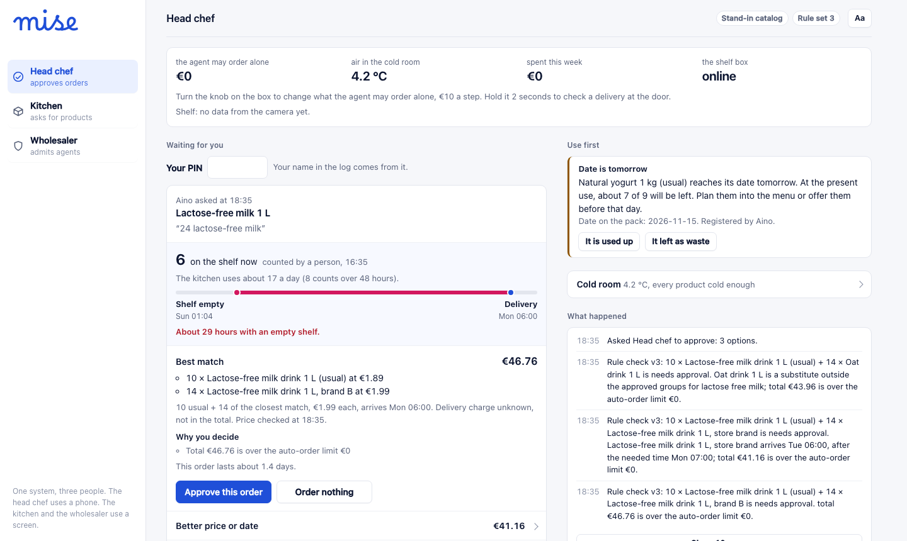
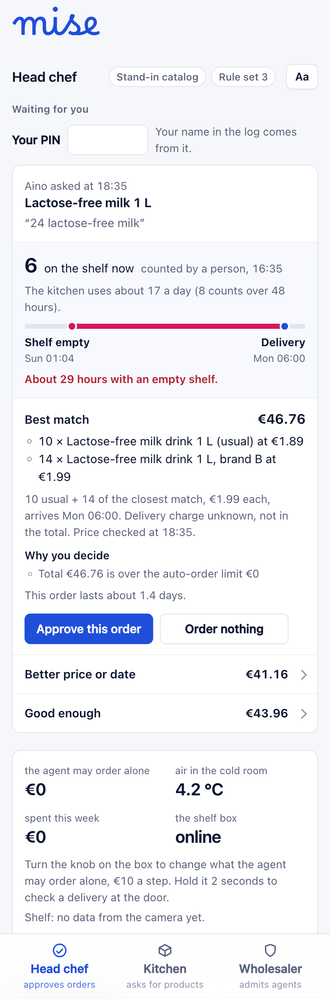
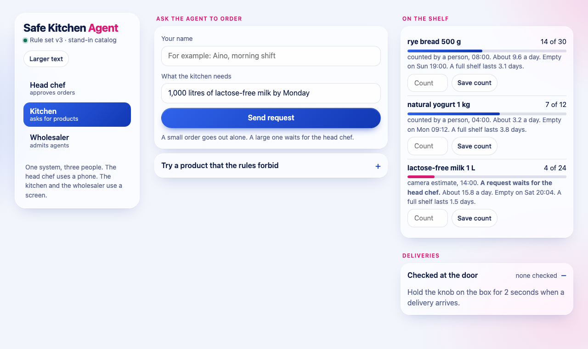
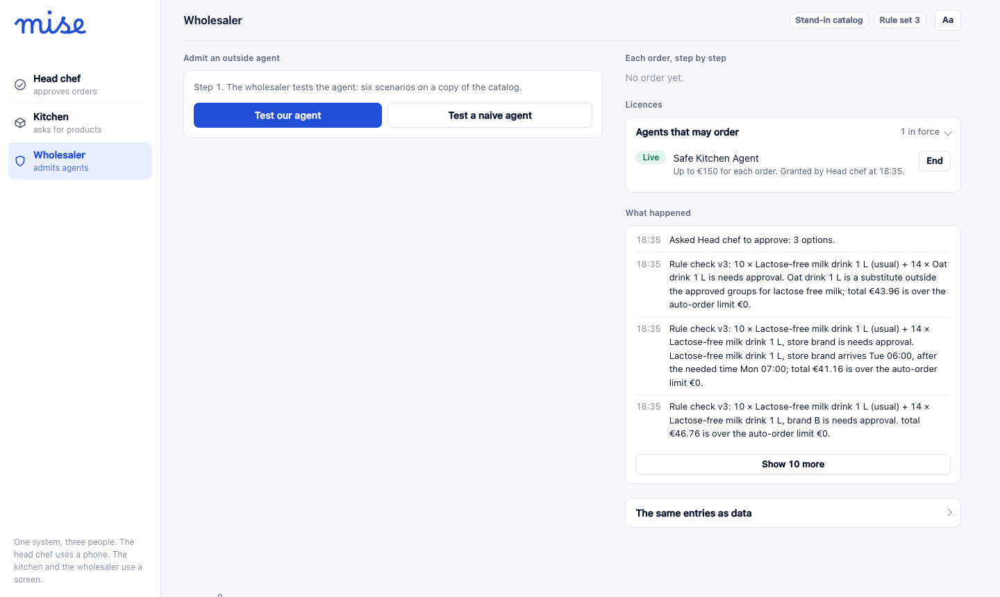

# mise: the Aimo Agent Gateway and its kitchen

**Try it online:** https://alejo-end--mise.us-east.modal.run/approve (hosted on Modal, on the stand-in catalog; the demo PIN of the head chef shows on the page; `deploy/modal_app.py` serves it).

Our entry to "Trusted Trade Agents" by Valio Aimo. Read `HANDBOOK.md` for the full explanation with pictures. The build brief is `DEMO_PLAN.md`.

## In brief

Valio Aimo asks how a wholesaler can let outside buying agents order safely. Our answer has two parts.

1. The Aimo Agent Gateway is the interface on the wholesaler's side. An outside agent takes a test, gets a licence with a spend limit, asks for a signed quote and orders it. An order within the limit goes out alone. Every other order waits for a person.
2. The Safe Kitchen Agent is one client of the gateway. It orders for a school kitchen inside rules that the head chef signed.

A language model can search, compare and explain. Plain code decides what is allowed.

## What it looks like

The page is called mise. One page serves three people, and each person sees only the own part.

**The head chef approves.** The card says who asked, what is on the shelf, how fast the kitchen uses the product and when the shelf runs out.

The same page on the head chef's phone:

**The kitchen asks, and sees the shelf.** Each slot shows its count, its use per day and what is on order. A person can type a count.

**The wholesaler admits agents.** An agent takes the Agent Driving Test, the head chef grants its licence with a PIN, and an approver can end the licence.

The pictures show the stand-in catalog and made-up shelf counts. No real kitchen data exists yet.

## Run it

Run every command from `valio-challenge/`. You need `uv`.

1. Put an approver PIN in `.env`, for example `APPROVER_PINS=4821:Head chef`.
2. Start the backend: `uv run uvicorn backend.app:app --host 0.0.0.0 --port 8000`.
3. Open `http://localhost:8000/approve`. Add `?as=kitchen` or `?as=valio` to open another role.
4. Run the tests: `uv run pytest`.

`HANDBOOK.md` says how to run on the real Valio catalog and how to set up the shelf box.

## What is true today

1. The gateway ran on the live Valio API on 14 November: a signed quote, an order and an approval.
2. The camera on the shelf estimates "full" or "low". It does not count. A distance sensor for a real count is not connected.
3. The Agent Driving Test has six scenarios that we wrote. No agent of another company took it yet.
4. The limits are in `HANDBOOK.md`, under "Limits to say out loud".
