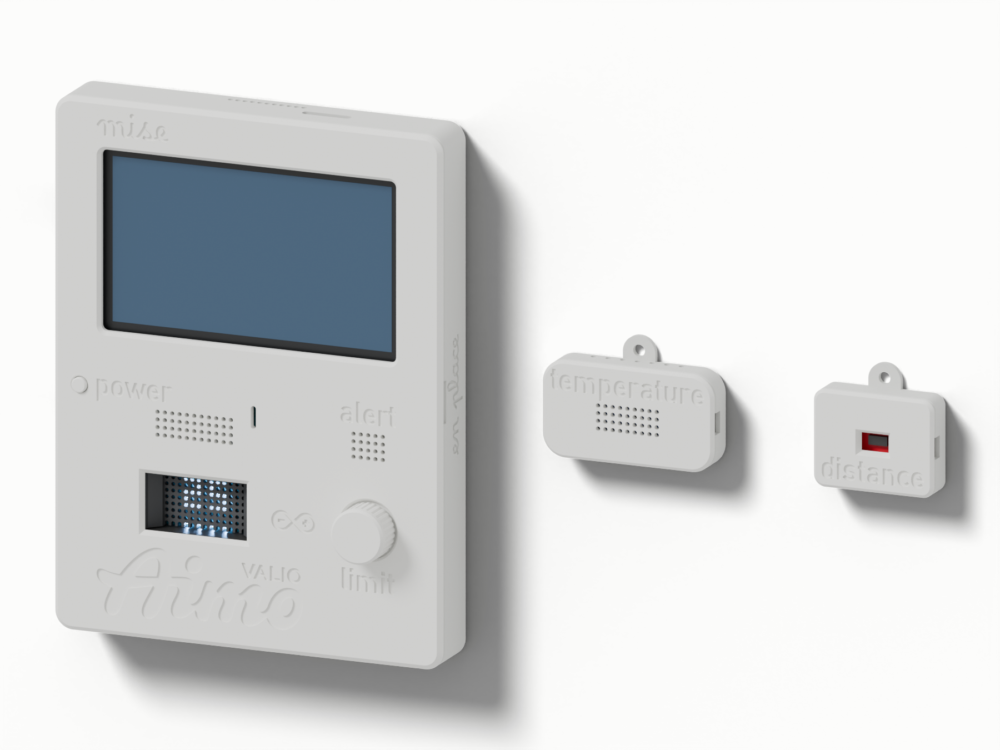
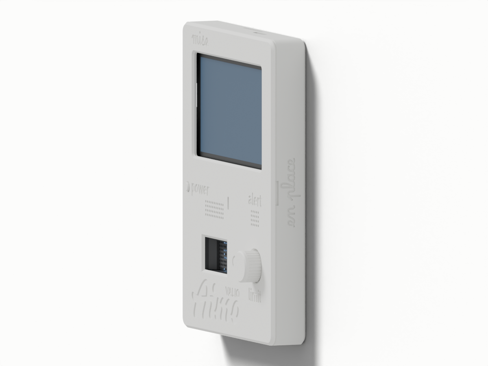
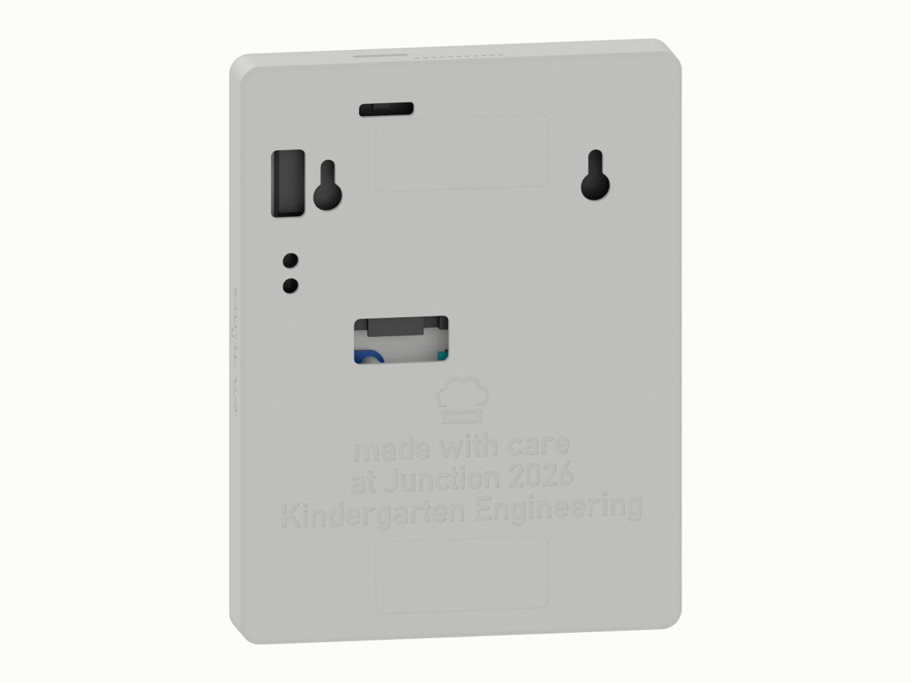
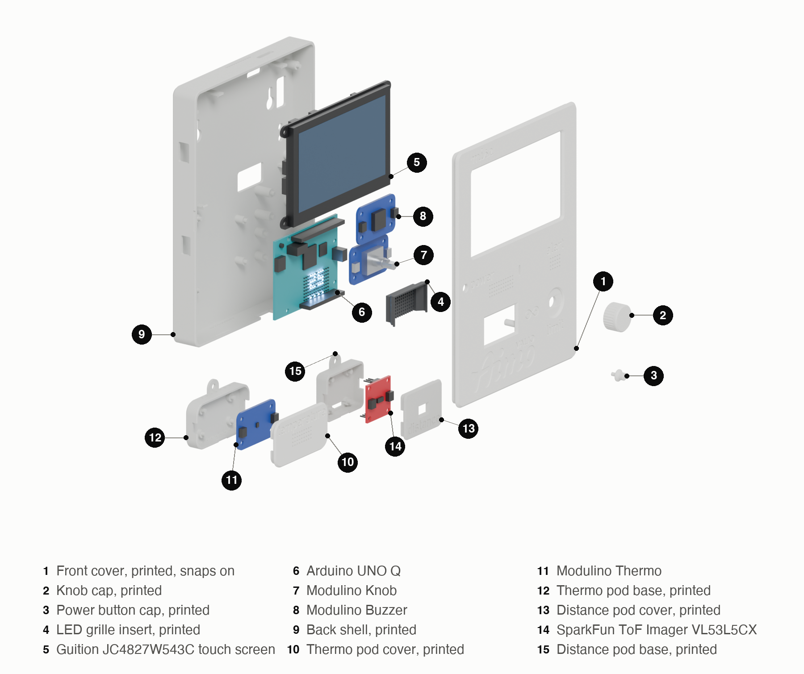

# SK-1 enclosure

This folder holds the 3D-printable case of "mise". The device is one housing that hangs on a wall, with two small pods for the outside sensors.

The housing holds four boards behind one front face:

1. The touch screen, a Guition JC4827W543C (ESP32-S3, 4.3 inch, 480 x 272, capacitive touch). It talks to the UNO Q over Wi-Fi.
2. The Arduino UNO Q.
3. The Modulino Knob, with a printed cap on the encoder shaft.
4. The Modulino Buzzer.

The two pods stay on their Qwiic cables:

1. The Thermo pod holds the Modulino Thermo. The Thermo can then sit in the cold room or in the delivery crate, away from the heat of the UNO Q.
2. The distance pod holds the SparkFun Qwiic ToF Imager VL53L5CX (SEN-18642, the 1 x 1 inch board). It looks at the shelf through a window in its cover.

No screw holds one part to another. The boards sit on pins, hooks on the back shell hold the screen, and each cover snaps on. The housing hangs on two wall screws, or on two adhesive strips.

The foot of the face carries the Valio Aimo logo. Valio Aimo is the partner of the challenge, and the logo says what the device was made for. The Valio Aimo logo is a trademark of Valio. It is shown here because the device was built for the Valio Aimo challenge at Junction 2026. A product for sale needs the permission of Valio.

`enclosure.py` builds all parts. Change a number at the top of the file and run it again to get new STL files.

```
uv run --no-project --with manifold3d --with numpy --with matplotlib python enclosure.py --preview
```

`--check` runs the tests and writes no file.

The script measures every label and mark first. If one breaks the print rule (see "Labels"), the script stops with a message that names the label. Then the script runs the clash check. It prints one line per test. If a test fails, the script stops with an error. The tests:

- Fit: no board touches a printed part. Each straight USB-C plug goes into its port and touches only the port. The cover sits in the back shell, the knob cap and the button cap sit in the cover, and no two printed parts touch.
- Screen: the cover clears the screen with the board 2 mm off in each direction and the glass 1 mm thicker. The whole picture stays visible with the board 2 mm off. The hooks hold the board. If every screen number changes by 1.5 mm, the front cover stays the same. There is free room for the plugs of P2 to P5. Tweezers reach the SD card through the back. A pen reaches SW1 through the top wall.
- LED matrix: the LED grille insert clears the UNO Q, its headers and the LEDs, and comes within 0.3 mm of the LEDs. It clears the rods, the standoffs and the caps. It touches the cover only by the press fit of its rim.
- Knob: the gap around the cap is even, 0.5 mm. The cap pressed 0.6 mm touches nothing.
- Button cap: it does not press the button at rest. It cannot fall out to the front. Pushed, it reaches the button. Pushed to the end of the button travel, it touches nothing else and still stands in front of the face.
- Mount: the screw heads pass the round holes, the shanks slide up the slots, and the heads clear every board. The strip fields clear every opening in the back and lie on the flat back.
- Labels: "en place" fits the right wall with 2 mm to each chamfer.
- Pods: the boards fit, the covers sit in their bases, and no printed part stands in the view of the distance sensor.
- Print: every STL is a valid solid (manifold3d status `NoError`) and fits the 250 x 210 mm bed of a Prusa CORE One.

I made each new test fail once on purpose: button cap, knob ring, mount, LED block, LED grille insert, cover independence, hooks, label rule and side text. Each one failed.

For the boards, the check uses the numbers in the script. "OK" says that the model agrees with itself. It does not say that the real boards fit. See "Measure before you print".

## Pictures



The device on the wall, seen from the right, with the two pods beside it.



The right wall of the housing, with `en place` along it.



The back of the housing, with the keyholes, the strip fields and the openings.



The parts of the housing and the two pods, pulled apart.

`cad/sk1_assembly.FCStd` is the same assembly as a FreeCAD file, with one group for the assembled device and one for the exploded view. In the file, the wall is the plane y = 0 and z is up.

The board models in the pictures are simple stand-ins. The headers, the USB-C port, the power button and the 104 LEDs of the UNO Q sit where the Arduino CAD data puts them. The parts on the back of the screen sit where the vendor drawing puts them, with estimated heights. The two chips on the UNO Q are drawn for the look only. The lit LEDs show the limit page of the sketch: "25" and the four page dots.

To make the pictures and the FreeCAD file again, run these four commands from this folder. You need FreeCAD and Blender.

```
uv run --no-project --with manifold3d --with numpy --with matplotlib python enclosure.py --assembly
/Applications/Blender.app/Contents/MacOS/Blender -b -P render_views.py -- "$PWD/assembly" "$PWD/renders"
uv run --no-project --with pillow python label_views.py
SK1_DIR="$PWD" /Applications/FreeCAD.app/Contents/Resources/bin/freecadcmd freecad_assembly.py
```

`enclosure.py` stays the one source of the geometry. The FreeCAD file is built from its meshes, so a round hole in it is a polygon with many sides. The last command also writes `cad/sk1_exploded.step`. Git ignores that file because of its size.

## Changes in this round

1. A printed button cap over the power button of the UNO Q (`stl/button.stl`).
2. The Valio Aimo logo in the foot of the face, traced from its image.
3. Every label and mark passes the print rule. If one does not, the script stops.
4. Chamfers and round corners on all outer edges, and broken edges on the openings.
5. A ring for the knob cap: a well with a 45 degree rim and an even 0.5 mm gap.
6. Two ways to hang the housing: keyhole slots and two fields for adhesive strips.
7. Snap bumps on all four walls, and one fit constant `FIT` for all clearances.
8. The fit test print also holds a snap sample and a label at full weight.
9. More tests in the clash check, and new pictures.
10. One hole over each of the 104 LEDs of the matrix, in a separate printed grille right above the LEDs (`LED_FACE = "insert"`). The cover has one window over it.
11. The front cover no longer depends on any estimated screen number. Hooks on the back shell hold the screen.
12. The screen orientation is fixed (USB-C on the left, the wider glass border at the bottom), with openings for the SD card and SW1.
13. "en place" runs along the right wall. The screen numbers come from the vendor drawing.

The housing grew from 132 x 144 to 132 x 174 mm. Four things need the height. The logo needs a foot of 23.7 mm (see "The logo"). The margin above the window is the margin beside it. The plugs of P2 to P5 need 6 mm of room under the screen. The window keeps the whole picture visible with the board 2 mm off.

## The housing

The housing is 132 mm wide, 174 mm high and 21.2 mm deep. With `PLUGS = "angled"` it is 160 mm wide. The knob cap stands 9.6 mm in front of the face and the button cap 1.0 mm.

The UNO Q sets the depth. From the back:

- 2 mm of back wall
- 6 mm of standoff, over the 5 mm connectors under the board
- 1.6 mm of board
- 8.5 mm of headers
- 0.6 mm of room
- 2.5 mm of front cover

The front is flat and parallel to the wall. Hang the device at eye height.

### Edges

| Edge | Treatment | Why |
|---|---|---|
| Face to side walls | 45 degree chamfer, 1.5 mm | The cover prints face down, so this edge lies on the bed. A fillet there prints badly |
| Back to side walls | 45 degree chamfer, 1.5 mm | The back shell prints back down, so this edge lies on the bed |
| Vertical corners | Round, radius 6 mm | Round in the print plane, so they print without trouble |
| Joint between cover and back shell | 45 degree chamfer, 0.5 mm on each side | The two chamfers make a small even groove, so a small step at the joint does not show |
| Pods | The same: 1 mm chamfer on each bed edge, 0.5 mm at the joint | The family matches |
| Screen window | 45 degree slope, 1.2 mm, corners round 2 mm | A finger reaches the edge of the picture |
| Knob well | 45 degree rim, 0.8 mm | It makes the visible ring |
| Button hole and button cap top | 45 degree chamfer, 0.4 mm | A clean edge where a finger presses |
| LED window | 45 degree walls from the insert to the face | The eye sees the plate from the side. In `"window"` mode: a 0.6 mm chamfer |
| LED holes and grille dots | none | The wall between two holes is 0.83 to 1.0 mm. A chamfer of 0.3 mm leaves 0.2 to 0.4 mm, which a 0.4 mm nozzle does not print |

All bed edges are chamfers, not fillets, so no part needs supports.

### Front face

The face has two axes and four lines, so every element lines up with another:

- The left axis is the left edge of the screen window (x = 14.6). `mise`, the window, the label `power` and the logo start on it.
- The right edge of the window and the right edge of the knob ring line up (x = 117.4). The window margin follows from this: 2.66 mm all round the active area.
- The knob column: `alert`, the speaker grille, the knob and `limit` share one centre line.
- The LED column: the vent and the LED field share one centre line.
- The label line: `power` and `alert` stand on one baseline. Its x-height is centred on the power button.
- The grille line: the vent and the speaker grille (4 rows each) share one centre line, over the buzzer.
- The lower row: the LED field, the Arduino mark and the knob share one centre line. The mark stands halfway between the LED window and the knob ring.
- The foot line: `limit` stands on the baseline of the small capitals VALIO in the logo.

The margin above the window is the margin beside it (15.1 and 14.6 mm). `mise` stands in that top margin, on the left axis.

The labels are engraved 0.6 mm deep. The name is in cursive letters with one stroke width. The font is Borel, in `fonts/` under the SIL Open Font License. All other labels use DIN.

The Arduino mark stands between the LED window and the knob, over the end of the UNO Q. It is an infinity sign with a minus in the left loop and a plus in the right loop, 15 x 7 mm. The script builds it from two arcs and two lines (`ARD_R`, `ARD_C`, `ARD_W`, `ARD_SIGN`). The Arduino mark is a trademark of Arduino. It is used here only to say that the device is built on an Arduino board.

### The right wall

`en place` runs along the right wall, centred on it. A person to the right of the housing reads it from bottom to top, like the spine of a book. The tops of the letters point toward the face.

A horizontal line of text does not fit there. The wall of the back shell is 18.7 mm deep, and with 2 mm to each chamfer 12.7 mm is left. At a size that prints, "en place" is 45 mm long. Set across the wall, its x-height is about 1.4 mm and its strokes are far under 1 mm. Along the wall it fits at an x-height of 4.5 mm, from 3.5 to 16.2 mm above the back.

The back shell prints back down, so this wall is upright in the print. The top edge of each engraved letter is a 0.6 mm overhang. It needs no support.

### Labels

The print rule for a 0.4 mm nozzle: the thinnest stroke is 1.0 mm or more, the thinnest gap is 0.5 mm or more, and the engraving is 0.6 mm deep or more. The script measures every label and mark. If one breaks the rule, the script stops.

| Text | Where | Size | Stroke | Gap | Depth |
|---|---|---|---|---|---|
| `power` | face | x-height 5.0 | 1.06 | 0.60 | 0.6 |
| `alert` | face | x-height 5.0 | 1.08 | 0.60 | 0.6 |
| `limit` | face | x-height 5.0 | 1.02 | 0.72 | 0.6 |
| `mise` | face | x-height 5.2 | 1.10 | 0.62 | 0.6 |
| Valio Aimo logo | face | 70.3 x 23.6 | 1.02 | 0.54 | 0.6 |
| `en place` | right wall | x-height 4.5 | 1.04 | 0.58 | 0.6 |
| `temperature` | Thermo pod cover | x-height 5.0 | 1.02 | 0.60 | 0.6 |
| `distance` | distance pod cover | x-height 5.0 | 1.02 | 0.60 | 0.6 |
| Arduino mark | face | 15 x 7 | 1.04 | 1.14 | 0.6 |

The script measures the stroke of each piece alone: each letter, dot, mark and part of the logo. Take away all that is narrower than the stroke. If a piece then loses a tenth of its area, it fails. A mitred opening keeps square corners, so a corner does not count as a thin stroke. An earlier version measured each label as a whole. That hid the thin crossbars of the DIN "t" and "e" (0.90 mm) and the bars of the Arduino mark (0.9 mm). So the DIN labels grew to an x-height of 5.0 with 0.13 mm of bold, and the bars of the mark to 1.05 mm.

The fixes of this round: `mise` grew from an x-height of 4.8 to 5.2 with less bold (its gap was 0.32). `en place` moved to the right wall (stroke 0.94, gap 0.40 before). The pod labels grew from 3.5 to 5.0 (stroke 0.80, gap 0.48 before), so the pods grew in length. The letters of a DIN label stand at least 0.7 mm apart (`MIN_GAP`). The script fills each hole in a letter that is narrower than 0.7 mm.

### The logo

`logos/valio_aimo.png` is the Valio Aimo logo, black on white, 1600 x 533 pixels. The script traces it each time it runs. It cuts the grey level at 50 % along the pixel edges and keeps each counter as a hole. Then it drops points that lie within 0.01 mm of the line through their neighbours. Nothing is redrawn.

The thinnest strokes are in the small capitals VALIO: 1.0 % of the logo width. The narrowest gap is between their L and I: 1.3 % of the width. A uniform outward offset makes the strokes thicker and the gaps narrower by the same amount. With an offset of 0.16 mm, 68 mm is the smallest width that passes the rule (stroke 1.00, gap 0.52). The logo is 70 mm wide before the offset and 70.3 x 23.6 mm after it, so it has a little room: stroke 1.02, gap 0.54. All four counters stay open.

No place of the face held a logo of that size. The walls of the back shell are only 12.7 mm high between their chamfers. So the foot grew to 23.7 mm. The logo stands on the left axis, 6.5 mm above the bottom edge. `limit` stands on the baseline of VALIO, under the knob. The check keeps three distances. The logo stays 3 mm under the LED window. `limit` stays 2.5 mm under the knob ring. The logo stays 5 mm from `limit`.

Every depth in the bed face is a whole number of 0.2 mm layers. If you print with another layer height, change `LAYER`.

### Inside

The UNO Q sits on the left of the control band on 6 mm standoffs, with its USB-C port at the left wall. The Knob and the Buzzer sit right of it, with 15 mm between them and the UNO Q for the Qwiic plugs. The place of each board on its own standoffs is the same as before.

The Knob standoffs are 5.9 mm tall. At this height, the smooth bushing of the encoder ends 0.2 mm below the face. The Buzzer standoffs are 11.5 mm tall. At this height, the buzzer sits 0.6 mm under the cover.

The screen sits above the control band on standoffs of 9.2 mm, so its glass is 1.5 mm under the cover.

## Print the front cover once

The front cover uses no estimated screen number. If the screen does not fit, measure it, change the screen numbers in `enclosure.py`, and print only the back shell again.

How this holds:

- The window comes from the active area `SCR_AA` (a standard panel value) and from the fixed centre `SCR_WIN_C`. The back shell places the board so that its active area sits under that centre, with the offset `SCR_AA_OFF` from the drawing.
- The window is 2.66 mm larger than the active area on each side. The whole picture stays visible with the board 2 mm off in any direction.
- The glass sits 1.5 mm under the cover (`SCR_GLASS_GAP`). A glass 1 mm thicker still clears it by 0.5 mm.
- The housing height comes from the window and the side margin, not from the board.
- No rod of the cover touches the screen. Four hooks on the back shell hold it.

| Cover feature | Numbers it uses |
|---|---|
| Outline, lip, bumps, tongues | `OX`, `OY`, `WALL`, `LIP_*`, `SNAP*`, `CORNER_R`, `EDGE`, `SEAM`, `OPENINGS` (UNO Q data) |
| Screen window | `SCR_AA`, `SCR_WIN_C`, `SCR_WIN_MARGIN`, `SCR_WIN_CHAMFER` |
| Rods | UNO Q and Modulino holes (CAD data). The screen has no rod |
| LED window and the pocket for the insert | UNO Q LED data, `LED_*`, `INSERT_*` |
| Knob well, button hole | Modulino and UNO Q data, `KNOB_*`, `BTN_*` |
| Labels, mark, vent, grille | the lines above, `X_L`, `LABEL_LINE`, `FOOT_LINE` |

The check proves it: it builds the cover again with every screen number changed by 1.5 mm and finds no difference.

## The fit constant

`FIT` at the top of the script is the one tolerance of the printer. Each clearance is `FIT` plus a fixed allowance for its kind of fit, so one edit loosens or tightens every fit together. After the fit test print: if the parts are too tight, increase `FIT` by 0.05. If they are loose, reduce it by 0.05.

| Fit | Formula | Value with `FIT = 0.10` |
|---|---|---|
| Cover lip in the walls, per side | `FIT` | 0.10 |
| Snap bump interference | `SNAP - FIT` | 0.20 (bump 0.30 past the lip face). Each groove is 0.05 larger in radius than its bump |
| Pin in a UNO Q or Modulino hole, on the diameter | `2 * (FIT + 0.075)` | 0.35 |
| Pin in a screen hole, on the diameter | `2 * (FIT + 0.175)` | 0.55 |
| Knob bore on the shaft, on the diameter | `2 * FIT` | 0.20 |
| Knob cap in its ring, per side | `FIT + 0.40` | 0.50 |
| Button cap in its hole, per side | `FIT + 0.10` | 0.20 |
| Cover tongue in the cable opening, per side | `FIT + 0.05` | 0.15 |
| Screen hook to the PCB edge | `FIT + 0.10` | 0.20 |
| Screen hook catch above the PCB | `FIT` | 0.10 |
| UNO Q plug opening | plug + `2 * (FIT + 0.15)`, `2 * (FIT + 0.40)` | 13.0 x 7.5 |
| Screen plug opening | plug + `2 * (FIT + 0.45)`, `2 * (FIT + 0.90)` | 13.6 x 8.5 |

## How the parts hold without screws

1. A pin on each standoff goes up through the mounting hole of each board.
2. Under the cover, a rod comes down over each pin of the UNO Q and the Modulinos and stops 0.2 mm above the board.
3. Four hooks on the back shell hold the screen: two on its top edge and two on its bottom edge. Each hook is an arm 5 mm wide and 1.6 mm thick that stands up from the floor beside the PCB edge. Its catch reaches 0.6 mm over the strip of PCB outside the glass. The glass is as wide as the PCB body, so the side edges have no free strip. When the board goes down, a 45 degree ramp above the catch pushes the arm out. The arm bends 0.8 mm, which is about 1.6 % strain in PLA. To take the board out, push the arms out with a fingernail.
4. A lip under the cover goes 3.5 mm into the walls. Bumps on all four walls click into grooves. There are two on the bottom wall, two on the top wall and two on each long side wall. On a long wall they stand at a quarter and at three quarters of its length. The long sides had no bump before.
5. A finger notch at the top of each side wall lets you lift the cover.

No part pushes on the cover at rest: the rods stop 0.2 mm above their boards, and the knob cap and the button cap do not press. So the only load on the cover is the snap itself. The bumps on the long sides hold those walls at two places each, 78 mm apart. The bow of the cover is not computed.

The pods work the same way, with a 3 mm lip, one bump on each long side and a finger notch in the front wall.

## The knob cap

The encoder shaft comes through the cover. `stl/knob.stl` is a cap for it, 18 mm wide, with grip grooves. Push the cap on the shaft until it stops on the shaft end.

- The cap stands in a round well of the cover, 19 mm wide and 1.6 mm deep, with a 45 degree rim of 0.8 mm. The gap around the cap is 0.5 mm all round, and the ring on the face is 20.6 mm wide.
- The cap goes 0.8 mm into the well, so no gap shows under it. The other 0.8 mm is room to press the encoder switch. Its travel is 0.5 mm (an estimate: the usual value for such an encoder, not in the Modulino data). The check presses the cap 0.6 mm and finds no contact.
- The bore of the cap has the D shape of the shaft. A slit behind the flat wall lets that wall bend.
- The cover is 1.5 mm thicker under the well. The well floor is a bridge with a hole in it. Two steps of one layer each let the printer lay straight lines around the hole.

## The power button cap

`stl/button.stl` sits in a 5.4 mm hole over the power button of the UNO Q (JBTN1). It is 10.2 mm long. From the top: a stem of 5.0 mm through the cover, then a 45 degree cone that widens to a flange of 8.0 mm under the cover. Last, a pusher of 2.4 mm reaches down to the button.

- The cone sits on the lower edge of the hole, so the cap cannot fall out to the front.
- At rest the cap stands 1.0 mm in front of the face, and the pusher is 0.4 mm above the button. It does not press the button at rest.
- Press the cap 0.4 mm and it touches the button. The button travels 0.25 mm more (an estimate). At that point the cap still stands 0.35 mm in front of the face, so a finger always feels it.
- The stem has 0.2 mm of room on each side, so it slides freely.

The button height (2.0 mm) and travel (0.25 mm) are estimates: the CAD data gives the place of the button, not its height. See "Measure before you print".

Before the cover goes on, put the cap in its hole from the inside of the cover. Hold it with a finger or a piece of tape on the face while you press the cover on.

## The LED matrix

The UNO Q has 104 LEDs, 13 columns by 8 rows. `LED_FACE` sets the face over them. All three ways use the same holes.

| Value | Number |
|---|---|
| Pitch | 2.178 mm between columns, 2.133 mm between rows |
| Hole | 1.3 mm (60 % of the pitch) |
| Wall between holes | 0.88 mm between columns, 0.83 mm between rows |
| Gap to the LEDs | 0.3 mm |

### The LED grille insert (the default)

`"insert"`: a separate printed part, `stl/led_grille.stl`, 36.4 x 20.3 x 9.0 mm. It has three pieces in one:

1. A plate, 1.6 mm thick, with one 1.3 mm hole over each LED. It lies 0.3 mm above the LEDs, so each dot is crisp and its light does not reach the next hole.
2. A sleeve of three walls, 0.9 mm thick. They stand straight up for 1.6 mm, clear of the low parts of the UNO Q, and then lean out at 45 degrees: 3.5 mm to the left and right, 2.0 mm to the top. A rod of the cover limits the right side, and the JSPI header limits the top.
3. A closed rim at the top, 1.0 mm high. It presses into a pocket under the cover.

The side toward the JANALOG header has no wall. The bottom row of holes is 0.66 mm from the header. So the plate ends 0.3 mm from the header, and those holes open to the plate edge. The black header body closes them.

Print it plate down. The holes stand upright, the walls lean out at 45 degrees, and nothing needs a support or a bridge.

The rim fits its pocket with 0.05 mm of interference on each side (`INSERT_PRESS = FIT - 0.15`). When you lift the cover off, the insert stays in it. If you loosen `FIT` by 0.05, the rim becomes a push fit with no play. If the press fit is too loose, the insert drops 0.3 mm and rests on the LEDs. It does not fall into the housing.

The gap of 0.3 mm rests on two estimates. The first is the LED height of 0.8 mm. The second is that no part within 1.2 mm of the LED pads is taller than the LEDs, except the JANALOG header. A taller LED or part makes the gap smaller. Check both on the board.

The cover has one window over the insert, 37.6 x 21.5 mm on the face. Its walls continue the 45 degree sleeve through the cover, so the face edge is a 45 degree chamfer. From the face to the plate it is 8.9 mm. The view angles, from straight on:

| Which dot, which way | Angle | What limits it |
|---|---|---|
| An outer dot, toward its own side | 25 degrees | the straight part of the sleeve wall |
| A dot of the bottom row, downward | 11 degrees | the JANALOG header |
| The middle of the field, sideways | 65 degrees | the window edge on the face |
| The middle of the field, upward | 53 degrees | the window edge on the face |

The holes of the plate are 1.6 mm deep and 0.3 mm above the LEDs. So a viewer sees the centre of an LED within about 19 degrees of straight on. Through the 10.5 mm channels of `"grid"` mode it was about 3 degrees. Beyond that angle a lit LED still lights the wall of its hole.

Print the insert in a dark filament and the cover in white. The plate then hides its own walls, and each lit dot is crisp. The two parts are separate, so this needs no colour change in a print.

### The other two ways

`"grid"`: one round hole over each LED through the cover. A light guide block under the cover, 8.0 mm high, reaches down to 0.3 mm above the LEDs, and each hole runs straight through it. Each channel is 10.5 mm long with the cover. So a viewer sees the centre of an LED only within about 3 degrees of straight on. With `LED_SKIN = 2 * LAYER` the first two layers stay closed over each hole: each dot then glows through 0.4 mm of plastic from any angle. That needs a light filament, and light PLA lets light through the 0.83 mm walls into the next dots.

`"window"`: one rectangular opening, 0.5 mm larger than the LED pads on each side, with a 0.6 mm chamfer on the face. A collar of 1.0 mm under the cover reaches down to 0.3 mm above the LEDs, so the board around the field does not show. On the header side the header body closes the collar.

### Where the LED positions come from

The pitch is derived. The CAD data gives the extents of all LED pads (31.29 to 58.43 by 4.51 to 20.44 mm), not the pads of one LED. The script assumes 1.0 mm of pad per LED. With any pad size from 0.4 to 1.6 mm, an outer LED moves by 0.3 mm or less. The 1.3 mm hole still shows it. `uno_q_template.svg` draws every hole: lay the board on it and check that each LED sits inside its circle. The fit test print also has a patch of the plate with 4 x 3 holes.

One slot, 1.8 mm wide, sits over the four RGB status LEDs of the UNO Q.

## Wall mount

Two ways, both on the flat back:

1. Two keyhole slots, 80 mm apart, behind the screen. They are made for screws with a 4 mm shank (`KEY_SCREW_D`). The head is up to 8 mm wide and 3.5 mm high (`KEY_HEAD_D`, `KEY_HEAD_H`). The round hole is 9 mm and the slot 4.6 mm. Put two screws in the wall, level, 80 mm apart. Leave each head 2.5 mm from the wall. Put the round holes over the heads and slide the housing down 9 mm. When the housing hangs, the screws are 143.3 mm above its bottom edge and 30.7 mm below its top edge. Inside, the heads clear the parts on the back of the screen by 2.2 mm.
2. Two adhesive strips. The back has two fields for them, 52 x 22 mm and 0.4 mm deep, one low and one high. The assumed strip is 20 x 50 mm, the large size of the usual removable mounting strips, up to 1.6 mm thick. The field keeps the strip in place, and the strip stands out of it to touch the wall. Each field is a 22 mm bridge in the print (the back lies on the bed).

The check proves four things. The heads pass the round holes. The shanks slide up the slots. The heads clear the boards and the hooks. The fields clear every opening in the back.

## Cables

Both USB-C ports face left. The constant `PLUGS` sets how their cables leave.

| `PLUGS` | USB-C cables | Width of the housing |
|---|---|---|
| `"straight"` (the default) | Each straight plug goes through its own opening in the left wall. The two cables leave to the left | 132 mm |
| `"angled"` | Plugs with a 90 degree side bend stay inside, in a room of 18 mm at the left. The cables leave through an opening in the bottom wall | 160 mm |

The Qwiic cables to the two pods leave through an opening in the bottom wall, between the UNO Q and the Modulinos.

With straight plugs:

- The opening for the UNO Q plug is 13.0 x 7.5 mm.
- The opening for the screen plug is 13.6 x 8.5 mm. The port of the screen is on the edge of the PCB body, 6.9 mm in from the ear tips. So the plug goes 10.9 mm into the housing. It passes between the two left ears of the screen.
- The clash check pushes a block of 12.5 x 6.5 mm, 20 mm long, into each port (`PLUG`). A thicker plug body does not go through: increase `UNO_PORT` or `SCR_PORT`.

The opening in the bottom wall is open toward the front. So before the cover goes on, you lay a cable in with its plug on. A tongue under the cover then closes it to a gap of 2.2 mm.

You need a USB-C hub with power pass-through beside the device. The camera and the power share the one USB-C port of the UNO Q.

## The screen: openings

- BOOT and RST: two 5 mm holes in the back. Lift the housing off its screws and press a button with a pen tip. The USB port starts the loader without them.
- SW1, the battery power button (press): a pen hole of 3 mm in the top wall, 16.7 mm long along the edge, and a slot in the back over SW1. SW1 is 10.2 mm inside the top wall. The schematic (VENDOR CLAIM) shows a 4-pin push button on the KEY pin of the charge chip U2. It turns the battery output on and off. On USB power you do not need it.
- TF1, the micro SD card: the socket is on the bottom edge of the screen, and that edge faces the control band inside the housing, not a wall. A slot in the bottom wall does not reach it. So the back has an opening of 28.6 x 14 mm under the mouth of the socket. Along the edge it is 6 mm longer than the socket on each side. Lift the housing off its screws and push the card in or pull it out with tweezers through that opening.
- P2 to P5: the cable entry faces down, out of the bottom edge. Below that edge there is 6.9 mm of free room. The check asks for 6 mm. That room leads to the cable gap between the UNO Q and the Modulinos. A cable from P2 to P5 runs along under the screen to that gap and leaves through the bottom opening.
- The antenna of the screen is at the right edge of its body. The back wall has an opening behind it.
- P1, P6 (battery) and P7 (speaker) have no opening.

Each pod has a cable slot in both end walls, so one cable from the housing feeds both pods: the housing, then the distance pod, then the Thermo pod.

## The pods

Each pod is long enough for its label at full weight: the Thermo pod is 58.4 x 31.8 x 11.2 mm, the distance pod 40.8 x 31.8 x 11.2 mm.

Each base has a hanging tab at the back: 11 mm wide, 8 mm past the back wall, 1.6 mm thick (the floor), with a 4 mm hole for a screw or a nail. It lies flat on the bed. The plastic around the hole is 2.8 mm at the end of the tab. Both pods have the same tab. The flat floor also takes an adhesive strip.

The floor of the distance pod has a slot under each row of header pads, so a board with soldered pin headers sits flat. The pins must point down. They come out about 4.5 mm below the pod, so hang the pod by its tab or put it on a soft pad. For a board without headers, set `TOF_PINS = []`.

The VL53L5CX sees a 63 degree cone on the diagonal. The window above it widens upward at 34 degrees from the axis. If a printed part stands in the cone up to 30 mm out, the clash check fails. Do not put glass or film over the window. A cover glass needs the crosstalk calibration of the ST driver. The VL53L5CX has the I2C address 0x29.

## Where the dimensions come from

The geometry of the Arduino and SparkFun boards comes from the CAD files of the makers.

| Board | Source |
|---|---|
| Arduino UNO Q (ABX00162) | Pad coordinates from the IPC-D-356 netlist and the drill file |
| Modulino Knob (ABX00107) | STEP model |
| Modulino Buzzer (ABX00108) | STEP model |
| Modulino Thermo (ABX00103) | STEP model |
| SparkFun Qwiic ToF Imager VL53L5CX (SEN-18642) | Eagle board file `Hardware/SparkFun Qwiic ToF Imager - VL53L5CX.brd` in [the SparkFun repository](https://github.com/sparkfun/SparkFun_Qwiic_ToF_Imager_VL53L5CX) |
| Guition JC4827W543C | Vendor structure drawing, see below |

The UNO Q download has no 3D model. The heights of the UNO Q parts come from the datasheet drawing: 8.5 mm for the headers and 5 mm for the connectors under the board. The button height and the LED height are estimates.

The SparkFun file gives the outline of 25.4 x 25.4 mm and four 3.302 mm holes, 2.54 mm from each edge. The module size, 6.4 x 3.0 x 1.5 mm, comes from the ST datasheet.

### The screen

The numbers come from the vendor structure drawing of the JC4827W543 (folder `3-Structure_Diagram` of the vendor package, mirrored at github.com/OldNKrusty/JC4827W543-ESP32S3-Guide). The drawing counts y from the top edge down. The script counts y from the bottom edge up, so y in the script = 70.2 minus y in the drawing. x is the same in both.

The levels are:

- VENDOR DRAWING (dimensioned): a dimension line of the drawing gives the number.
- VENDOR DRAWING (measured): measured on the render of the drawing, scaled from the dimensioned numbers. About 0.3 mm.
- VENDOR CLAIM: the vendor schematic (V0.2) says so.
- WEB: a web page states the number.
- STANDARD PANEL VALUE: the usual number for a 4.3 inch, 480 x 272 panel.
- ESTIMATE: a guess. Measure it on the board.

| Constant | Value (mm) | What it is | Level |
|---|---|---|---|
| `SCR_X`, `SCR_Y` | 120.0 x 70.2 | Outline over the ear tips | VENDOR DRAWING (dimensioned) |
| `SCR_HOLE_DX`, `SCR_HOLE_DY` | 112.6, 62.1 | Distance between the hole centres. The holes sit at 3.7 and 4.05 from the edges | VENDOR DRAWING (dimensioned) |
| `SCR_HOLE_D` | 3.2 | Mounting holes | VENDOR DRAWING (dimensioned) |
| `SCR_BODY`, `SCR_EAR_H` | x 6.9 to 113.1, ears 8.2 high | The PCB body, and four round ears with the holes | VENDOR DRAWING (measured) |
| `SCR_LCD`, `SCR_LCD_OFF` | 106.1 x 67.4, (-0.05, 0.1) | Glass outline, as wide as the body | VENDOR DRAWING (measured) |
| `SCR_AA` | 95.04 x 53.86 | Active area | STANDARD PANEL VALUE, and WEB |
| `SCR_AA_OFF` | (0, 1.7) | Centre of the active area from the PCB centre. Borders: 4.6 at the top, 7.7 at the bottom | VENDOR DRAWING (measured) |
| `SCR_USB_Y`, `SCR_USB_FACE` | 40.4, -6.9 | USB-C port on the left body edge, mouth flush with the body | VENDOR DRAWING (measured) |
| `SCR_BOOT`, `SCR_RST` | (111.1, 24.1), (111.1, 16.5) | The two buttons | VENDOR DRAWING (measured) |
| `SCR_ANT` | x 106.6 to 113.1, y 37.0 to 57.7 | Antenna end of the ESP32-S3 module | VENDOR DRAWING (measured) |
| `SCR_TF` | x 69.7 to 86.3, 1.7 past the bottom edge | TF1, micro SD socket | VENDOR DRAWING (measured) |
| `SCR_SOCKETS` | x 17.3 to 65.2, bottom edge | P5, P4, P3, P2 | VENDOR DRAWING (measured) |
| `SCR_SW1`, `SCR_P6`, `SCR_P7` | top edge | SW1, battery and speaker sockets | VENDOR DRAWING (measured) |
| `SCR_P1`, `SCR_LCD1`, `SCR_ESP` | | P1, display flex connector, ESP32-S3 module | VENDOR DRAWING (measured) |
| `SCR_TOTAL_T` | 9.5 | Thickness of the module | WEB: make.net.za, for the version without touch |
| `SCR_T` | 1.6 | PCB thickness | ESTIMATE |
| `SCR_BACK_H` | 3.5 | Tallest part on the back | ESTIMATE |
| `SCR_LCD_H` | 4.4 | From the PCB front to the glass front. It is `SCR_TOTAL_T` less the two numbers above | ESTIMATE |
| `SCR_USB_Z` | 1.6 | USB-C port centre behind the PCB back | ESTIMATE |
| Heights of the parts on the back | 1.0 to 3.4 | | ESTIMATE |

## Parts

| File | Size (mm) | Print orientation |
|---|---|---|
| `stl/back.stl` | 132 x 174 x 18.7 | Back on the bed |
| `stl/front.stl` | 132 x 174 x 11.5 (2.5 plate, with a lip, rods and the light guide under it) | Front face on the bed |
| `stl/knob.stl` | 18 diameter x 10.4 | Top face on the bed |
| `stl/button.stl` | 8 diameter x 10.2 | Top face on the bed. The stem stands on 5 mm, so use a brim |
| `stl/led_grille.stl` | 36.4 x 20.3 x 9.0 | Plate on the bed. Print it in a dark filament |
| `stl/thermo_pod_base.stl` | 58.4 x 39.8 x 9.2, with the tab | Floor on the bed |
| `stl/thermo_pod_cover.stl` | 58.4 x 31.8 x 5.4, with a lip under it | Top face on the bed |
| `stl/tof_pod_base.stl` | 40.8 x 39.8 x 9.2, with the tab and two slots for header pins | Floor on the bed |
| `stl/tof_pod_cover.stl` | 40.8 x 31.8 x 5.4, with a lip under it | Top face on the bed |
| `stl/screen_fit_test.stl` | 128.0 x 78.2 x 7.1 | Frame on the bed. A test print, not a part of the device |

The back of the back shell carries a small engraved mark, 0.6 mm deep in the face that lies on the bed. It passes the same print rule as the labels and stays 3 mm from every opening.

Each STL file has the part in its print orientation. The script checks that each fits the 250 x 210 mm bed. No part needs supports.

Use 0.2 mm layers, 3 walls and 20 % infill. The labels are 0.6 mm deep in the face that lies on the bed, so use a smooth or satin print sheet. Print the LED grille insert in a dark filament (see "The LED matrix").

Four features can print with a rough surface:

1. The end of each rod over the UNO Q. The wall around the hole for the pin is 0.5 mm, one line of a 0.4 mm nozzle.
2. The front cover is a thin plate of 132 x 174 mm. If it lifts at the corners, use a brim.
3. The top of each plug opening in the left wall, and of the pen hole over SW1, is a short bridge.
4. The ceiling of each strip field is a 22 mm bridge.

Nothing is sliced yet. Slice the STL files before you print.

## The fit test print

`stl/screen_fit_test.stl` is one small print, 128 x 78 mm and 11.9 cm3, with four loose pieces:

1. A frame with the four screen pins and the four screen hooks, as in the back shell, and a rim around the PCB outline. Put the screen on it: it must drop onto the pins and click under the hooks, and the USB-C port must sit in the gap of the rim.
2. A small shell, 54 x 24 mm, with one groove.
3. A small cover with one bump and the small capitals VALIO of the logo at full weight, engraved like the face. They have the least margin to the print rule. It prints face down.
4. A patch of the LED grille plate, 1.6 mm thick, with 4 x 3 holes of 1.3 mm at the pitch of the LEDs. Look at the holes and the 0.83 mm walls between them. If the holes close up, increase `LED_HOLE_D` a little.

Pieces 2, 3 and 4 lie inside the frame. Take them off the bed after the print. Press the small cover into the small shell: it must click and hold. Then read the label. The lip, the groove and the bump have the cross sections of the housing. A short wall is stiffer than the long walls of the housing, so the sample clicks a little harder than the housing.

If the snap is too tight or the pins too tight, increase `FIT`. If they are loose, reduce it.

## Measure before you print

The vendor drawing gives the outline, the holes and the place of the parts. It gives no height. Check these in four steps before you print the housing:

1. Print `screen_template.svg` on paper at 100 %. It draws the screen as the model assumes it. It shows the ears, the holes, the glass, the active area, every named part on the back and the four hooks. First measure the 100 mm line on the paper. Then lay the board on the front view, display up, USB-C port on the left, and on the back view, display down.
2. Measure the heights with a caliper and change the constants: `SCR_T`, `SCR_LCD_H` (from the PCB front to the glass front), `SCR_BACK_H` and the height of each part on the back. A screen part higher than 5.7 mm hits the floor, and higher than 2.2 mm over a wall screw head it hits the head.
3. Print `uno_q_template.svg` at 100 % and lay the UNO Q on it. Each LED must sit inside its green circle. Measure the LED height (`UNO_LED_H`, now 0.8). Measure the height and the travel of the power button (`UNO_BUTTON_H`, `UNO_BUTTON_TRAVEL`, now 2.0 and 0.25). Check that no part within 1.2 mm of the LED field is taller than the LEDs.
4. Print `stl/screen_fit_test.stl` (see above).

If a screen number changes, run the script again and print only the back shell. The front cover stays valid.

## Assembly

1. Put the UNO Q, the Knob and the Buzzer on their pins in the back shell.
2. Hold the screen with the display toward you and the USB-C port on the left. Press it onto its four pins until the four hooks click over its top and bottom edges.
3. Connect the UNO Q Qwiic port to the left port of the Knob.
4. Connect the right port of the Knob to the right port of the Buzzer.
5. Connect the left port of the Buzzer to the distance pod with a 500 mm cable. Lay the cable in the opening of the bottom wall.
6. Press the LED grille insert into its pocket under the front cover, plate away from the cover. Put the button cap in its hole from the inside of the cover and hold it with tape on the face. Press the cover down until the bumps click. Remove the tape. Push the knob cap on the shaft.
7. Push a USB-C plug through each opening in the left wall: the lower one into the UNO Q, the upper one into the screen.
8. Remove the tape from the VL53L5CX. Put the board on the pins of its pod, sensor up.
9. Connect the cable from the housing to one socket. Connect the other socket to the Thermo with a second 500 mm cable. Lay both cables in the slots, then press the cover on.
10. Put the Thermo on the pins of its pod, connect the cable, and press the cover on.
11. Hang the housing on the two wall screws, or press it onto two adhesive strips in the fields of the back.

## The knob, the LED matrix and the screen

The knob has two gestures. A turn sets the spend limit, €10 a step, so the label below the knob says `limit`. A full hold starts a 60 s delivery check: a bar fills the bottom row of the LED matrix first, and a release before it is full does nothing. A tap does nothing.

The LED matrix behind the dot grille shows the spend limit and a level bar. When a person is needed it shows one symbol instead: a thermometer for a cold alarm, a parcel for a delivery at the door, or a ring with "!" for an order to approve.

The buzzer, behind the grille with the label `alert`, chimes after a hold and sounds an alarm.

The touch screen shows the data and takes the decisions that need context: accept or reject a delivery, confirm a cold alarm, report a slot low. `../screen/README.md` describes it.

## Hardware

| Item | Quantity |
|---|---|
| Wall screw, 4 mm shank, head up to 8 mm wide, with a wall plug that fits the wall | 2 |
| Or: removable adhesive mounting strip, 20 x 50 mm, up to 1.6 mm thick | 2 |
| USB-C cable with a straight plug, body up to 12.5 x 6.5 mm | 2 |
| USB-C hub with power pass-through | 1 |
| Qwiic cable, 50 mm or 100 mm | 2 |
| Qwiic cable, 500 mm | 2 |
