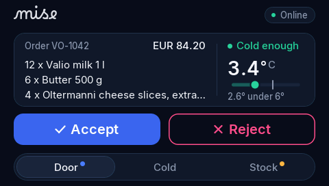
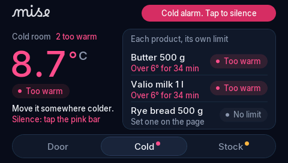
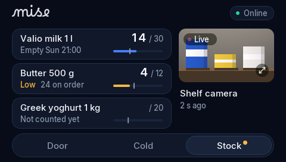
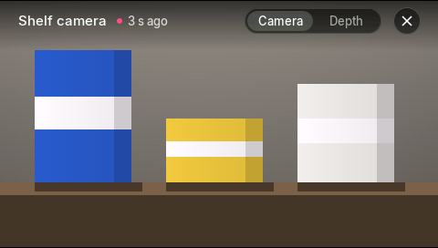
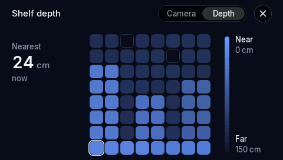

# The touch screen of the box

A Guition JC4827W543C: an ESP32-S3 with a 4.3 inch touch display of 480 by 272 pixels. It answers one question that the knob cannot: what am I accepting?

The screen joins the Wi-Fi and asks the backend for its view every 2 seconds (`GET /box/screen`). It has three views, with a segmented control along the bottom edge: Door, Cold and Stock. A tap on a segment opens that view.

The screen opens on the view that the backend names in the field `view`. If a delivery waits or an alarm runs, that is the door. Else it is the cold room. When a delivery arrives or an alarm starts, the screen goes to the door at once. After a minute without a touch, it goes back to the backend's view and closes any open question.

  

- **Door.** A card with the order: its number, its total and its lines. Beside them is the verdict: "Cold enough", "Too warm" or "Check before use". Under the verdict are the air at the box in large figures and a gauge. The gauge shows the air as a dot and the limit of the order's coldest product as a mark. A line under the gauge says how far the air is under the limit, or how long it was above it. Two buttons: "Accept" and "Reject". A tap on one opens a sheet that asks once more ("Reject this delivery?"). The backend writes the decision into the log and the order record, with the temperature. If nothing is at the door, the view shows a calm sign and "Nothing at the door". It also shows the orders that wait for the head chef, and the cold room in one line.
- **Cold.** The air at the box now in large figures (pink while a product is too warm), a chip with the state, what a person does now, and how to silence the buzzer. At the right, each shelf product with its own limit: "Too warm" in pink with the minutes above the limit, "OK" in green, or "No limit". The head chef sets the limits on the page, with the PIN.
- **Stock.** One row for each shelf slot. A row shows the name, the count against the target, and a bar with a mark at the reorder point. A note under the name gives the time the slot runs empty, the units on order, or a warning that the count is old. A slot under its reorder point shows "Low" and an amber bar. A tap on a row selects it and "Report low" slides in. A tap on that opens the sheet. "Yes, report" sends the same event as a press on the knob (`manual_low`, with the source `screen`). The backend runs the purchase before it answers, so the screen waits up to 15 seconds and the sheet says so. Beside the rows, the shelf camera (see below).

A tap on the capsule "Cold alarm. Tap to silence" in the top bar tells the backend that a person saw the alarm: the buzzer of the box is quiet for 10 minutes. It works from any view. When all is well, the capsule says "Online". Else it says "No Wi-Fi", "No backend" or "Box offline" in pink.

After a decision, a toast says what happened: a circle with a check or a cross, a title and one line. It fades after 2.6 seconds.

The screen has no PIN. It never approves an order and never spends money. That stays on the phone.

## The shelf camera

The Stock view shows the newest picture of the shelf camera at 160 by 90 pixels. A "Live" chip and the age ("2 s ago") go with it. If the picture is older than 10 seconds, or if there is no picture, the thumbnail becomes a dark placeholder. The placeholder shows a drawn camera and "Camera offline". A tap on the thumbnail opens the picture at 480 by 270. It slides up in 280 ms. A tap anywhere, or 30 seconds without a touch, closes it. A new picture fades in over the old one in 220 ms.

The backend serves `GET /box/camera.rgb565?w=160&h=90` (and `w=480&h=270`): raw RGB565, 2 bytes for each pixel, little-endian, row by row, with the headers `X-Frame-Age`, `X-Frame-Width` and `X-Frame-Height`. If it has no picture, it answers 204. The screen asks for the thumbnail every 500 ms, and only while the Stock view shows. It asks for the large picture 250 ms after the last one arrived, and only while that view shows the picture. The framebuffer holds native RGB565 words, which are little-endian on the ESP32, so a picture goes into its buffer with no byte swap.



## The distance sensor

The large view has two modes, "Camera" and "Depth", in a small segmented control in its title strip. It opens on "Camera" and keeps the choice while it stays open. A tap on the control changes the mode, and the two modes cross-fade in 200 ms. A tap anywhere else closes the view.

"Depth" shows the 8 by 8 grid of the distance sensor (a SparkFun VL53L5CX) as rounded square cells. The colour of a cell gives its distance on a straight scale from 0 to 150 cm, the depth of a shelf. Near is a bright accent blue and far is a deep navy close to the page. A cell with no reading is a faint outline. The nearest cell has a thin white ring. The left column shows the nearest distance ("Nearest 24 cm") and the age of the reading. The right column shows the legend: "Near" and "0 cm" at the top of a colour bar, "Far" and "150 cm" at its foot. Each new reading eases every cell to its new colour in 150 ms.

The cells carry no numbers. With 64 numbers the grid read like a table, and the numbers of 3 digits did not fit the cells of 23 pixels.

If no reading exists, or if the newest one is older than 5 seconds, the sensor counts as offline. The grid then shows only the outlines of the cells. The left column says "Distance sensor offline" and gives the age of the last reading.

The backend serves `GET /box/tof`: JSON with `cm` (64 numbers or null, row by row, row 0 first, as the sensor sees it), `age` in seconds, `rows` and `cols`. If no reading ever arrived, it answers 204. The screen asks for it every 300 ms, and only while the large view shows "Depth". It does not fetch the large picture while "Depth" shows.

The Stock view has no depth glyph beside the thumbnail. The screen fetches the sensor only in "Depth", so a glyph in the Stock view shows an old reading. Also, the thumbnail column has no room for a clean glyph.



## The design

The screen is dark and calm, like the display of a good kitchen appliance. The page is a near-black navy (#0A0F1C). Cards are one step lighter (#121A2B). The active segment, a selected row and the sheet are raised (#1A2438). One colour serves for every hairline (#24304A). Text is near-white (#F2F5FA) with one grey for captions (#8B97AD). A darker grey (#5B6780) is for decoration only, never for text that a person must read.

Each colour has one meaning:

- Blue (#4F7DFF, filled #3A66EA): action and selection.
- Pink (#FF4D8D, filled #D42C65): the cold alarm and "too warm".
- Green (#2FD39A): "fine".
- Amber (#FFB547): a slot that runs low.

For a slot that runs low, the brief asked for a pink dot on the Stock segment. The screen uses amber there instead, so pink always means temperature. A person who sees pink knows to look at the cold.

Contrast against the surfaces, measured on the RGB565 values that the panel gets:

| Text | Page | Card | Raised |
| --- | --- | --- | --- |
| Primary #F2F5FA | 18.3 | 16.6 | 14.5 |
| Caption #8B97AD | 6.6 | 6.0 | 5.2 |
| Pink #FF4D8D | 6.2 | 5.6 | 4.9 |
| Green #2FD39A | 10.0 | 9.1 | 8.0 |
| Amber #FFB547 | 11.2 | 10.1 | 8.9 |

White on the blue button is 4.9 to 1, on the pink button 4.8 to 1.

Type carries the design. The font is Inter, in these sizes:

- 13 Medium for captions.
- 15 Regular for body text, and 15 Medium for labels.
- 20 SemiBold for titles and buttons.
- 28 SemiBold for the temperature at the door.
- 60 Medium for the hero temperature in the Cold view.

The number sizes have tabular digits. A changed number thus keeps its width. Labels are in sentence case. The sides have a margin of 20 pixels, and most measures sit on a grid of 8 pixels. The wordmark "mise" is Borel, in white, small in the top left.

Motion is short and has a reason. Each motion takes 180 to 320 ms with a cubic ease out, and an entry moves at most 12 pixels:

- Tab switch: the highlight of the segmented control slides. The old view fades out with a small shift and the new one fades in from the other side.
- Values: a changed temperature or count rolls, digit by digit, to the new value in 320 ms.
- Chart: on entering the Cold view, the line draws itself from left to right in 520 ms.
- Buttons: a pressed button is darker and 2 pixels smaller for 90 ms before it acts.
- Sheet: it becomes opaque in 110 ms and rises 12 pixels in 260 ms. The view under it dims.
- Toast: the circle grows in, the check or cross draws itself as a stroke, then it all fades.

Only three things loop: the halo of the newest point in the chart, the pulse of the alarm capsule, and the "Live" dot of the camera. All three are slow. The age captions of the camera and the distance sensor count up once a second.

The camera view is the one motion that moves more than 12 pixels: it slides up the whole height of the screen, as the owner asked. Its title strip lies over the picture on a soft shade, so the picture keeps the full 480 by 270 pixels.

## How the screen draws

The look is plain C++ in `src/ui/`, with no Arduino calls:

- `canvas.*`: a 480 by 272 RGB565 framebuffer and the shapes. Each shape takes its anti-aliasing from a signed distance: fills, rounded rectangles, capsules, circles, rings, and lines with round ends. Gradients and soft shadows use ordered dithering against the steps of RGB565. A canvas has alpha blending and a clip rectangle. It also has an opacity and an offset for a whole view, so a view can fade and slide. Text comes from 4-bit glyph atlases.
- `model.*`: what the screen knows and how a touch changes it. It holds the backend's last answer, the open tab, the question that waits for "Yes", and the selected slot. It also holds the toast, the camera, and the clocks of the animations. Each change that the screen must show sets `dirty`. An unchanged answer leaves it clear.
- `draw.*`: the palette and the drawing of a whole frame from the model at a given time.
- `font_*.h`, `wordmark_*.h`: the atlases that `tools/make_fonts.py` writes.

`screen.ino` keeps what needs the board: the panel, the touch chip and its calibration, the Wi-Fi, the flash and the network. The framebuffer and the pictures live in PSRAM. The loop draws a frame in three cases only: the model changed, a motion runs, or a dot breathes (about 12 frames a second). It then compares the frame with the one on the panel and sends only the rectangle that changed, with one `draw16bitRGBBitmap` call. An unchanged answer sends nothing. Arduino_GFX takes native RGB565 words and sends them most significant byte first, as the panel wants. Every motion takes its progress from the clock, so a slow frame makes a motion skip, never last longer.

A task on core 0 fetches the view every 2 seconds and the camera pictures while they show. The loop on core 1 takes each new answer, so a slow network does not stop a motion or a touch. A decision and a "Report low" still block the loop while they wait for the backend (up to 4 and 15 seconds), as before. The pressed button or the waiting sheet shows during that time.

### Frame time

On the laptop, a whole frame renders in about 0.3 ms. The ESP32-S3 at 240 MHz is roughly 50 times slower for this kind of code, and the frame is in PSRAM. The estimate for one frame on the board:

| Step | Time |
| --- | --- |
| Render the whole frame | 15 to 25 ms |
| Compare with the frame on the panel | 5 to 10 ms |
| Send the full frame at 20 MHz | about 50 ms (measured at bring-up) |
| Send a small change, for example the breathing halo | 1 to 2 ms |

A motion over the whole screen therefore runs at about 12 to 15 frames a second. A tab switch changes the body and the tabs, about 80 % of the rows. Each of its frames thus sends about 40 ms of data. A breathing dot costs about 25 ms of the loop for each frame, 12 times a second. The sketch prints the real numbers to the serial monitor every 10 seconds: frames, average render time, average send time and pixels sent.

## The preview on the laptop

`tools/preview.cpp` includes the same UI code and draws every important state and some animations into PNG files in `preview/`. Run it from this folder:

```
c++ -std=c++17 -O2 -Wall -Wextra -Isrc/ui tools/preview.cpp src/ui/*.cpp -o /tmp/mise-preview
/tmp/mise-preview preview
```

With a second folder as an argument (`/tmp/mise-preview preview /tmp/zoom`), it also writes each state at twice the size. It writes PPM files and converts them with `sips`. It uses a drawn test picture for the camera: a wall, a shelf board and three products.

The files whose names begin with `motion-` are contact sheets: frames of one motion at half size, with the time above each frame.

## The fonts

The fonts are in `fonts/`: Inter Regular, Medium and SemiBold. Inter is Copyright 2016 The Inter Project Authors and is under the SIL Open Font License 1.1 (https://openfontlicense.org). See `fonts/OFL.txt`. The wordmark comes from Borel in `../enclosure/fonts/`, also under the SIL Open Font License 1.1.

`tools/make_fonts.py` renders ASCII 32 to 126, an ellipsis and a degree sign into 4-bit alpha atlases, as C headers in `src/ui/`. The hero size holds only the digits and `+ , - . /`. It also renders the wordmark at two sizes. Run it from this folder:

```
uv run --with pillow --with numpy python tools/make_fonts.py
```

The atlases and the wordmark take about 54 KB of flash. The program is 1,232,567 bytes, 39 % of the app partition of 3 MB.

## Build and flash

1. Copy `secrets.example.h` to `secrets.h`. Fill in the Wi-Fi name, the password and the address of the backend. Git ignores `secrets.h`.
2. Connect the screen to the laptop with a USB-C data cable.
3. Compile and upload. Replace the port with the one that `arduino-cli board list` shows.

```
arduino-cli compile --fqbn esp32:esp32:esp32s3:FlashSize=4M,PSRAM=opi,PartitionScheme=huge_app,CDCOnBoot=cdc screen
arduino-cli upload  --fqbn esp32:esp32:esp32s3:FlashSize=4M,PSRAM=opi,PartitionScheme=huge_app,CDCOnBoot=cdc -p /dev/cu.usbmodem101 screen
```

The libraries are "GFX Library for Arduino" 1.6.9 and ArduinoJson 7. The build needs `PSRAM=opi`: without PSRAM the screen shows one line that says so.

## Hardware facts that the sketch relies on

These come from a bring-up of this exact board with other firmware.

- The panel is an NV3041A on four data lines. It needs the start-up table of the factory firmware, which is in `src/factory_init_table.h`. The table of the display library differs.
- Colour inversion is off. The sketch turns the picture 180 degrees (rotation 2), so it is upright with USB-C on the right, as the screen sits in the box. The touch calibration stays in the panel's own frame, so a stored calibration still works after the turn.
- A full frame of 480 by 272 pixels takes about 49.5 ms at 20 MHz.
- The touch chip is a GT911 at address 0x5D on pins 8 and 4. The sketch reads it and never configures it.
- Pin 1 switches the backlight.

## Touch calibration

At its first start the screen shows four crosses, one after another. Tap the centre of each one. The screen works out how a touch reading becomes a place on the display, also for swapped or mirrored axes. It keeps the result in its flash. On this board both axes came out mirrored, with a scale within 5 % of 1.

To calibrate again, hold a finger on the name "mise" for 3 seconds. The backend can also ask for it: `POST /box/screen/recalibrate`. The screen then shows the crosses within 2 seconds.

## What is tested

On 14 November the earlier sketch ran on the board. The display showed the right colours. The screen joined the Wi-Fi and fetched its view every 2 seconds. After the calibration, taps landed on the buttons, and four decisions from the screen reached the backend's log with the temperature. The backend view and the decisions have tests.

On 15 November the new look was checked in the laptop preview, state by state and frame by frame. The sketch compiles with no warnings in its own files.

Not tested on the panel yet:

- The framebuffer in PSRAM, the comparison with the shown frame, and the transfer of a rectangle with `draw16bitRGBBitmap`. The byte order follows the library's code, but no frame of this sketch went to the panel yet.
- The real frame times and how smooth the motions look at 12 to 15 frames a second.
- The fetch task on core 0 next to the requests of the loop.
- The camera and distance sensor endpoints, which the backend gains at the same time as this sketch.
- How the colours, the thin lines and the 13 pixel captions look on this panel, which has its own gamma.
- A long run, the battery connector, and the screen in a cold room.

## Wiring

None for data. Power the screen from its own USB-C. Do not put a Qwiic cable into the small 4-pin socket: it joins the 3.3 V lines of the two boards.
